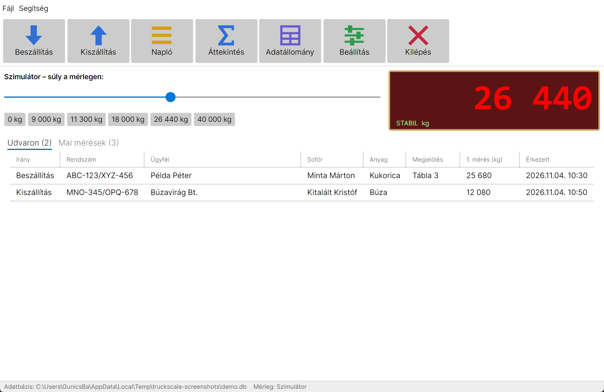
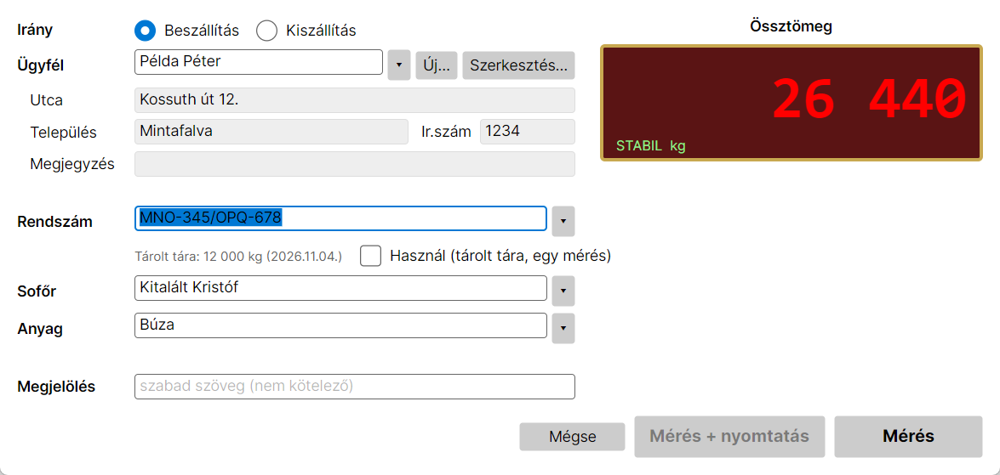
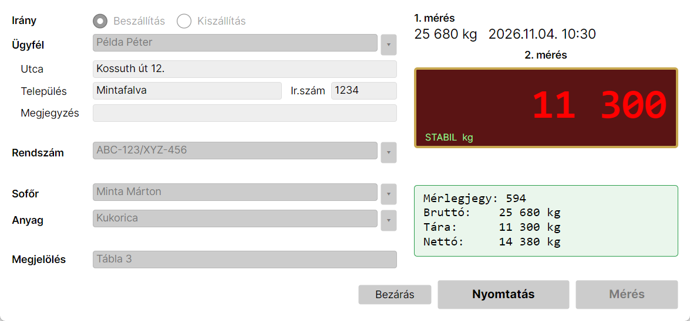
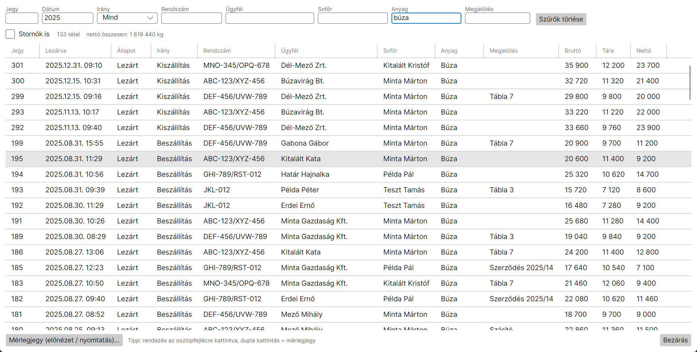
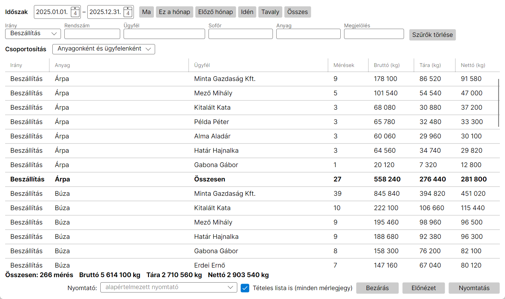

# Truck Scale

Cross-platform truck scale (hídmérleg) program for a farm weighbridge: two-step weighing, stored tare,
printed weighing tickets, history and summaries. A remake of the old Windows-only *TS.exe* (LIS120).

C# / .NET 10 · [Avalonia](https://avaloniaui.net/) UI · SQLite · Windows, Linux, macOS



**Felhasználói útmutató (magyar):** [docs/FELHASZNALOI_UTMUTATO.md](docs/FELHASZNALOI_UTMUTATO.md)

## Features

- **Weighing:** Beszállítás / Kiszállítás (inbound / outbound).
  - The arrival screen is pre-filled from the last weighing.
  - Trucks wait in the **yard list** for their second weighing.
  - **Mérés + nyomtatás** (weigh and print) closes the ticket, prints it and closes the window in one step.
  - **Használ** (stored tare) closes a ticket with a single weighing.
  - **Stornó** cancels an open weighing; it is kept, not deleted.
- **Lists:** customers with address; plates and drivers are independent of the customer, since one truck hauls for many customers.
- **Tickets:** printed from the old program's `.form` layouts (or a built-in A4 layout), with preview and zoom. Any past ticket can be reprinted.
- **Napló (history):** every weighing, with per-column filters and sortable columns.
- **Áttekintés (summary):** totals for any period, per grain and per customer, printable over multiple pages.
- **Scale:** serial indicator sending `ST,GL,   12340kg` lines (ST = stable); built-in simulator for testing without a scale.
- **Migration:** imports the old `DATA.LIS` (Access/Jet) database. It merges duplicate plates, drivers and customers and checks the totals against the old data.

| | |
|---|---|
|  |  |
|  |  |

*(Screenshots use fictional demo data.)*

## Download

Get the latest package from **[Releases](../../releases)** and unzip it; nothing to install.

| System | Package |
|---|---|
| Windows | `TruckScale-<version>-win-x64.zip` → `TruckScale.exe` |
| Linux | `TruckScale-<version>-linux-x64.tar.gz` → `./TruckScale` |
| macOS | `TruckScale-<version>-osx-arm64.tar.gz` (Apple Silicon) / `osx-x64` (Intel) |
| Old data import (Windows) | `TruckScale.Import-<version>-win-x86.zip` |

Ticket printing currently works on Windows; the previews work everywhere.

## Running

```
TruckScale.exe [--db path\to\truckscale.db] [--sim]
```

- Default database: `%APPDATA%\TruckScale\truckscale.db` (`~/.config/TruckScale/` on Linux). It is created empty if it does not exist.
- `--sim` uses the simulator instead of the serial port. The simulator is also used automatically when the configured port does not exist.

## Migrating the old data (Windows)

```
TruckScale.Import.exe "<path>\DATA.LIS" truckscale.db --ini TS.ini
```

The importer works on a temporary copy of `DATA.LIS` and never changes it. See [docs/DATABASE.md](docs/DATABASE.md) for the old and new database structure.

## Development

```
dotnet build                                        # everything
dotnet test                                         # unit tests
dotnet run --project src/TruckScale.App -- --sim    # run with the simulator
dotnet run --project tools/TruckScale.Demo -- demo.db   # fictional demo database
powershell -File tools\Screenshots.ps1              # regenerate docs/images from the demo database (Windows)
```

| Project | |
|---|---|
| `src/TruckScale.Core` | Database (SQLite), weighing rules, ticket forms, summaries, scale protocol |
| `src/TruckScale.App` | Avalonia desktop program |
| `tools/TruckScale.Import` | Migration from the old `DATA.LIS` (Windows, 32-bit Jet driver) |
| `tools/TruckScale.Demo` | Generates a demo database with fictional data |
| `tests/TruckScale.Core.Tests` | xUnit tests |

### Releases

`.github/workflows/release.yml` builds all packages when a version tag is pushed and attaches them to a GitHub Release:

```
git tag v1.0.0
git push origin v1.0.0
```

Running the workflow manually (*Actions → Release → Run workflow*) builds the same packages as artifacts without creating a release. `ci.yml` builds and tests every push to `main` and every pull request.

Real data (`DATA.LIS`, `*.db`, `TS.ini`, `*.form`) is excluded by `.gitignore`. Never commit it: it contains customer data.
