# Truck Scale – Felhasználói útmutató

Hídmérleg-program a be- és kiszállított terményekhez: mérlegelés, mérlegjegy nyomtatása, napló és összesítők.

> A képek kitalált mintaadatokkal készültek (Minta Gazdaság Kft.).

**Tartalom:**
[Indítás](#indítás) ·
[Főablak](#főablak) ·
[Beszállítás / kiszállítás](#beszállítás--kiszállítás-első-mérés) ·
[Távozás](#távozás-második-mérés-és-mérlegjegy) ·
[Használ](#használ-tárolt-tára-egy-mérés) ·
[Stornó](#stornó) ·
[Napló](#napló-összes-mérés-újranyomtatás) ·
[Áttekintés](#áttekintés-összesítő) ·
[Adatállomány](#adatállomány-ügyfelek) ·
[Beállítás](#beállítás) ·
[Adatmentés](#adatok-és-mentés) ·
[Gyakori kérdések](#gyakori-kérdések)

---

## Indítás

A programot a `TruckScale.exe` indítja, telepíteni nem kell.

- Az adatok egyetlen fájlban vannak: `truckscale.db`. Ha mást nem adunk meg, a program a felhasználó mappájában tárolja (`%APPDATA%\TruckScale\truckscale.db`). Első indításkor üresen hozza létre.
- Másik adatfájlt így lehet megadni: `TruckScale.exe --db D:\Mérleg\truckscale.db`
- Mérleg nélkül (próbához): `TruckScale.exe --sim`. Ilyenkor egy csúszkával lehet „súlyt tenni” a mérlegre.
- **Nyelv:** a **Nyelv** menüben (vagy a Beállításban) magyar és angol közül lehet választani. A program felajánlja az újraindítást, utána minden felirat, a dátum- és a számformátum is az új nyelven jelenik meg.

## Főablak

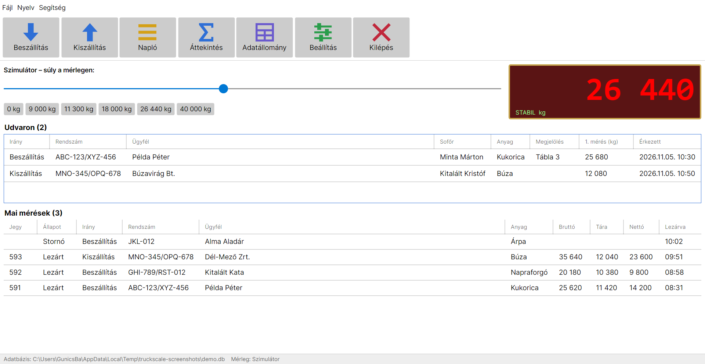

- **Felül** a gombsor: Beszállítás, Kiszállítás, Napló, Áttekintés, Adatállomány, Beállítás, Kilépés.
- **Jobbra** a mérleg kijelzője:
  - **STABIL:** a súly nyugalomban van, lehet mérni.
  - **MOZGÁS:** a súly még változik, várni kell.
  - **NINCS KAPCSOLAT:** a program nem kap adatot a mérlegtől.
- A program **teljes képernyőn** indul.
- **Új verzió:** induláskor a program megnézi a GitHubon, van-e újabb kiadás. Ha van, felül sárga sáv jelenik meg, a **Letöltés oldal megnyitása** gomb a letöltési oldalra visz. Internet nélkül nem történik semmi. A keresés a Beállításban (Program rész) kikapcsolható. A frissítés: a régi programmappát le kell cserélni az új zip tartalmára. Az adatok (`truckscale.db`) máshol vannak, azok megmaradnak.
- **Lent** két lista egymás alatt:
  - **Udvaron** (felül, kék keretben): a bent lévő járművek, akiknek még nincs meg a második mérésük. Három jármű fér el benne görgetés nélkül.
  - **Mai mérések:** a ma lezárt jegyek. Dupla kattintással megnyílik a mérlegjegy, és újranyomtatható.
- **A legalsó sor** mutatja, melyik adatfájllal és melyik mérleggel (soros port vagy szimulátor) dolgozik a program.

## Beszállítás / kiszállítás (első mérés)

A **Beszállítás** vagy **Kiszállítás** gomb a „Jármű érkezése” ablakot nyitja meg. A mezőkben **az előző mérés adatai** vannak, így ha ugyanaz a jármű jön, elég ellenőrizni és mérni.

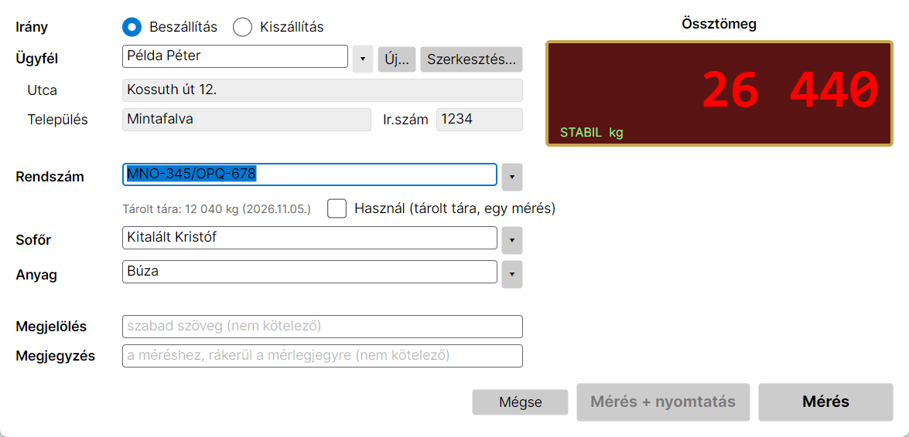

| Mező | Tudnivaló |
|---|---|
| **Ügyfél** | Választani kell a listából. Gépelni is lehet, ilyenkor szűr a lista (az ékezet nem számít). A **↑ / ↓** nyíl lépteti az ügyfeleket. Alatta a cím csak olvasható, és ha az ügyfélnek van megjegyzése, az is látszik. |
| **Új…** | Új ügyfél felvétele (név, cím, megjegyzés). |
| **Szerkesztés…** | A kiválasztott ügyfél adatainak javítása. |
| **Rendszám** | Választható vagy beírható. Új rendszámot a program magától felvesz. Ha a listából választod, a szokásos sofőrt is beírja. Az írásmód nem számít: „ABC-123/XYZ-456” = „abc123 xyz456”. |
| **Tárolt tára / Használ** | A jármű utolsó mért üres súlya. Lásd [Használ](#használ-tárolt-tára-egy-mérés). |
| **Sofőr, Anyag** | Választható vagy beírható. Az újakat a program felveszi. |
| **Megjelölés** | Szabad szöveg, nem kötelező (pl. tábla, szerződésszám). Rákerül a jegyre. |
| **Megjegyzés** | A mérés saját megjegyzése (pl. „szárítóba”, nedvesség). Távozáskor is javítható, és rákerül a mérlegjegyre. |

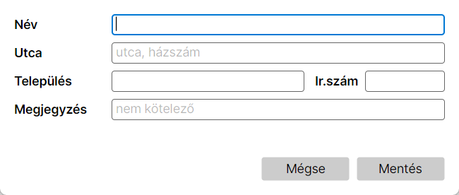

**Billentyűzettel:** a **Tab** mezőről mezőre lép (Ügyfél → Rendszám → … → Megjelölés), az **Enter** a fő gombot nyomja meg.

**Mérés:** ha a kijelző STABIL, a **Mérés** rögzíti az első súlyt. A jármű ezután megjelenik a főablak **Udvaron** listájában.

> Ugyanaz a rendszám nem lehet kétszer az udvaron. Ilyenkor előbb az előzőt kell lezárni vagy stornózni.

## Távozás (második mérés és mérlegjegy)

Amikor a jármű távozik, a főablak **Udvaron** listájában **dupla kattintással** (vagy kijelölés + **Enter**) nyílik meg.

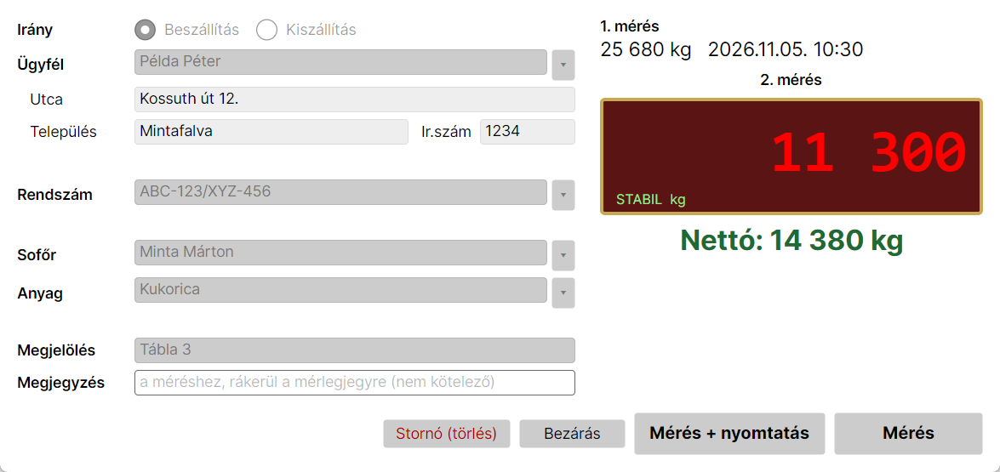

A kijelző alatt zölddel látszik a **Nettó**, amit a Mérés most adna: az első és a mostani súly különbsége. A mérleg mozgása közben halványan látszik, és már a Mérés megnyomása előtt ellenőrizhető.

Itt már csak a **Megjegyzés** módosítható (lezáráskor elmentődik), minden más rögzített:

- **Mérés + nyomtatás** (és az **Enter** is): lemér, lezárja a jegyet, kinyomtatja a mérlegjegyet, és bezárja az ablakot. A nyomtatás ideje alatt a jegyszám és a nettó súly látszik.
- **Mérés:** csak lezár és megmutatja az eredményt. A **Nyomtatás** gombbal ugyanott ki lehet nyomtatni.
- **Stornó (törlés):** lásd [Stornó](#stornó).
- **Bezárás:** változtatás nélkül bezárja az ablakot, a jármű az udvaron marad.

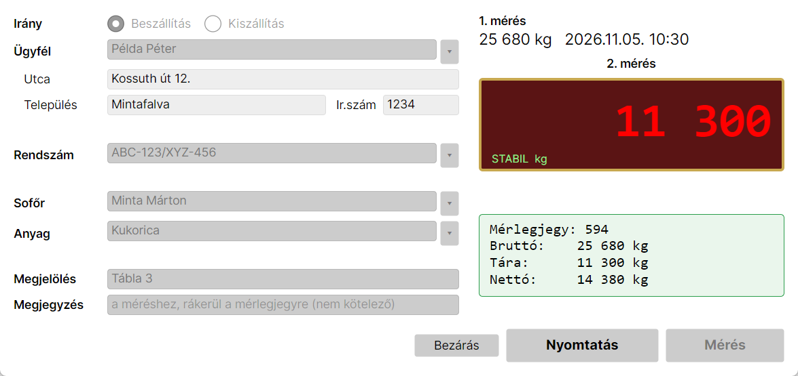

A program a nagyobb súlyt veszi bruttónak, a kisebbet tárának. Beszállításnál tehát először a rakott, kiszállításnál először az üres járművet kell mérni. Ha a két mérés szinte azonos (200 kg-on belül), a program rákérdez, biztosan lezárja-e.

Lezáráskor a program **eltárolja a jármű tárasúlyát**, ezt használja legközelebb a „Használ” funkció.

## Használ (tárolt tára, egy mérés)

Ha a jármű üres súlya már ismert (Tárolt tára), elég **egyszer**, rakottan mérni:

1. Pipáld be a **Használ** jelölőt.
2. Nyomd meg a **Mérés + nyomtatás** gombot (vagy az Entert).

A **Nettó** (mért súly − tárolt tára) a Mérés előtt is látszik a kijelző alatt. A program a mért súlyból levonja a tárolt tárát, lezárja és kinyomtatja a jegyet. A jármű nem kerül az udvarra.

## Mérés 0 kg-hoz (pl. zsákos áru)

A mérés **üres mérlegnél (0 kg)** is lehetséges, például ha zsákos árut mérünk, és a zsák súlya elhanyagolható. Az első mérés 0 kg, a második a rakott súly, a nettó így maga az áru. A program 0 kg-nál rákérdez, biztosan ehhez mér-e. Negatív súllyal nem lehet mérni.

## Stornó

Ha egy bent lévő járműnél valami hibás (rossz ügyfél, rossz anyag), az udvaron lévő mérést **Stornóval** lehet megszüntetni, aztán újra kell kezdeni helyesen. A stornózott mérés nem törlődik, „Stornó” állapotban megmarad, de nem kap jegyszámot, és nem számít bele az összesítőkbe.

## Napló (összes mérés, újranyomtatás)

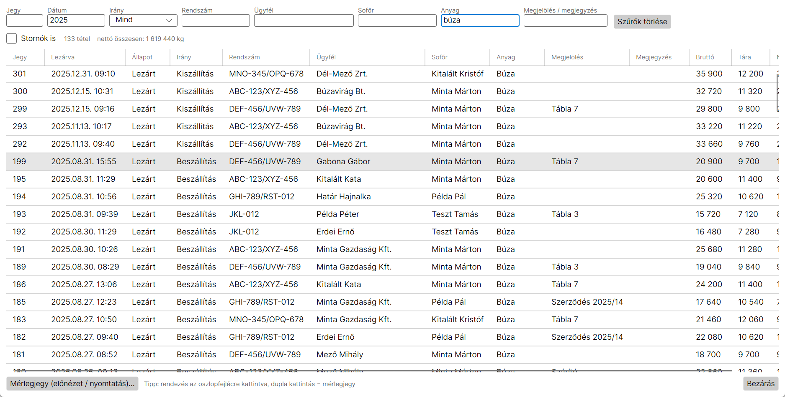

- Minden lezárt mérés benne van, a legújabb felül.
- **Oszloponként lehet keresni** a felső mezőkben (Jegy, Dátum, Irány, Rendszám, Ügyfél, Sofőr, Anyag, Megjelölés). A kitöltött mezők együtt szűrnek. A dátumhoz elég egy részlet: „2025” vagy „2025.07”.
- Az oszlopfejlécre kattintva rendezni lehet.
- A **Stornók is** jelölővel a stornózott mérések is látszanak.
- **Dupla kattintás** egy sorra megnyitja a mérlegjegyet, ott **Nyomtatás** gombbal bármikor újranyomtatható.

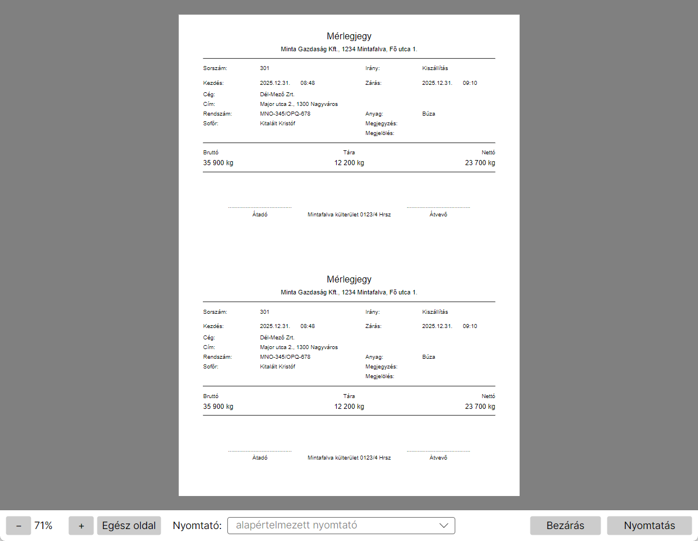

Az előnézetben a **− / +** gombbal vagy **Ctrl + egérgörgővel** lehet nagyítani, az **Egész oldal** visszaállít.

## Áttekintés (összesítő)

Mennyi termény jött be vagy ment ki egy időszakban, és kitől.

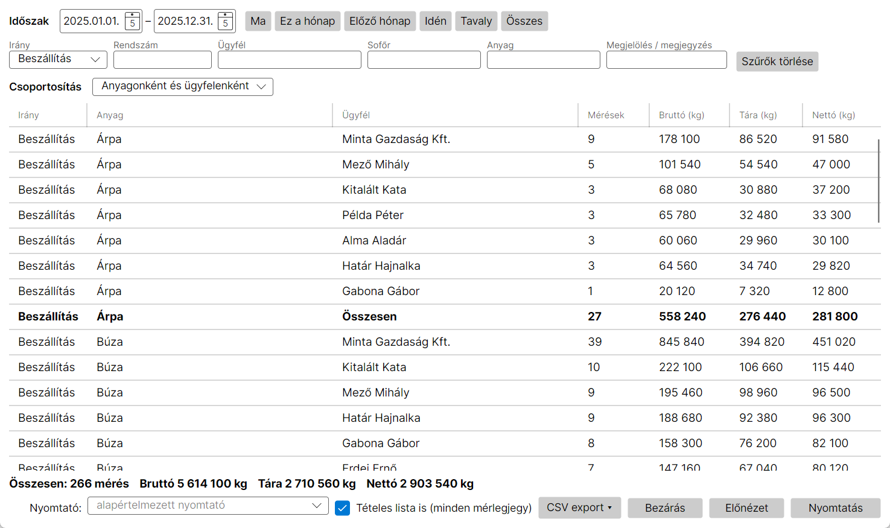

1. **Időszak:** két dátum, vagy gyorsgomb (Ma, Ez a hónap, Előző hónap, Idén, Tavaly, Összes).
2. **Szűrés:** ugyanazok a mezők, mint a Naplóban (pl. Irány = Beszállítás, Anyag = „búza”).
3. **Csoportosítás:**
   - **Anyagonként:** terményenként egy sor.
   - **Anyagonként és ügyfelenként:** terményenként, azon belül kitől jött (a legtöbbtől a legkevesebbig), terményenként félkövér összesennel.
   - **Ügyfelenként és anyagonként:** ügyfelenként, azon belül milyen termény.
4. Lent a teljes összeg: mérések száma, bruttó, tára, nettó.

**CSV export ▾:** az adatok Excelben megnyitható fájlba menthetők:
- **Összesítő táblázat:** a képernyőn látható csoportosítás és részösszegek,
- **Tételes (minden mérés):** a szűrésnek megfelelő összes mérés soronként (jegyszám, dátumok, rendszám, ügyfél, sofőr, anyag, megjelölés, megjegyzés, bruttó, tára, nettó).

A fájl pontosvesszővel tagolt, a súlyok egész számok, így Excelben összeadhatók.

Az **Előnézet** a nyomtatandó oldalakat mutatja, a **Nyomtatás** kinyomtatja őket. A **Tételes lista is** jelölővel az összesítő után az összes mérlegjegy is felkerül a listára.

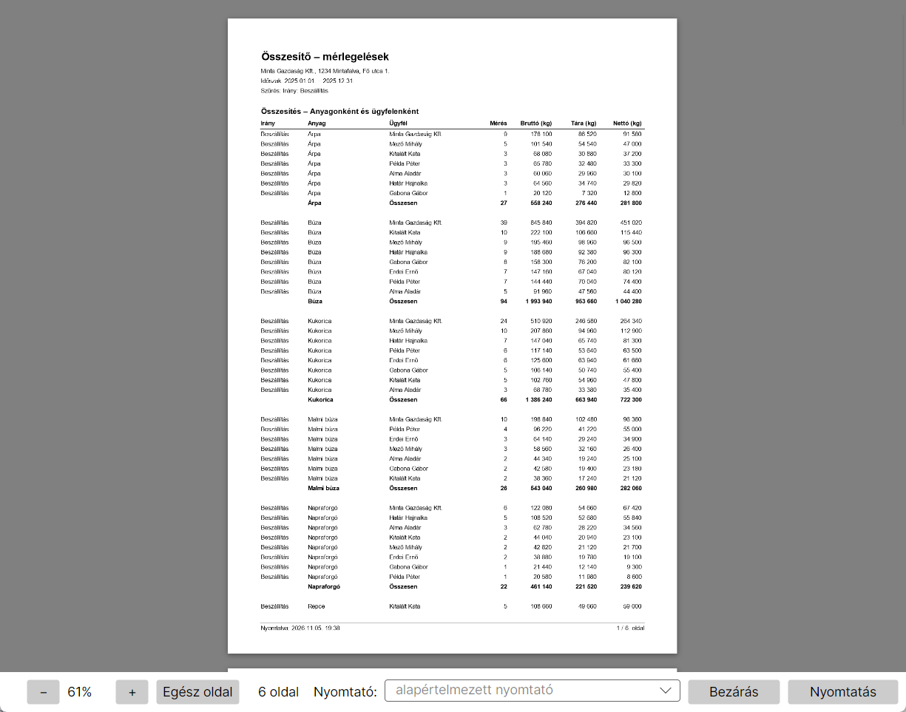

## Adatállomány (ügyfelek)

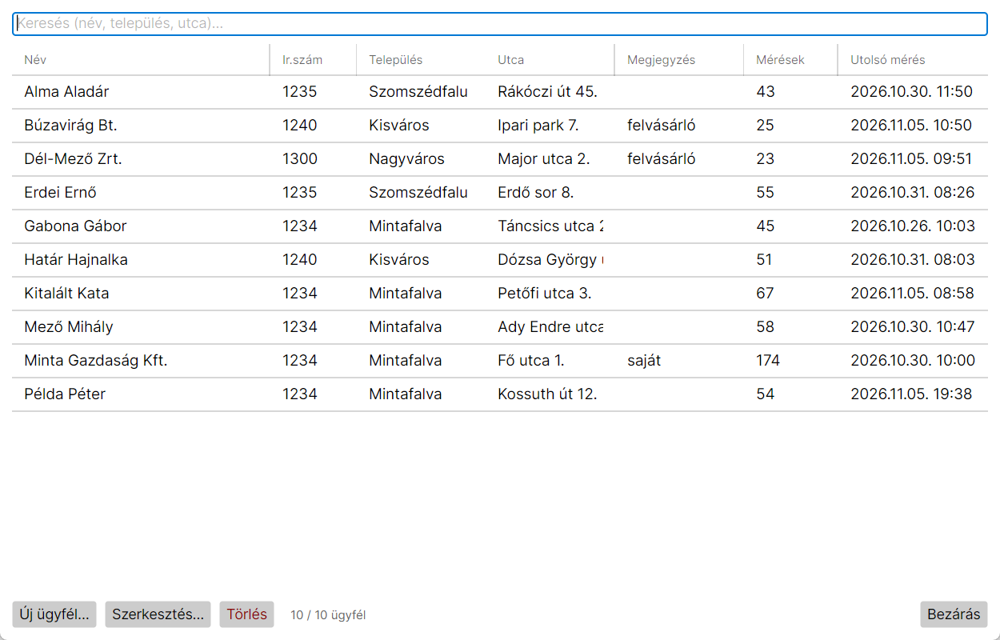

- **Kereshető** a név, a település vagy az utca alapján.
- Látszik, hány mérése volt az ügyfélnek, és mikor volt az utolsó.
- **Új ügyfél…**, **Szerkesztés…** (vagy dupla kattintás), **Törlés**.
- A **Törlés** csak a listából veszi ki az ügyfelet, a korábbi mérései és mérlegjegyei megmaradnak. Ha az ügyfél járműve éppen az udvaron van, nem törölhető.

## Beállítás

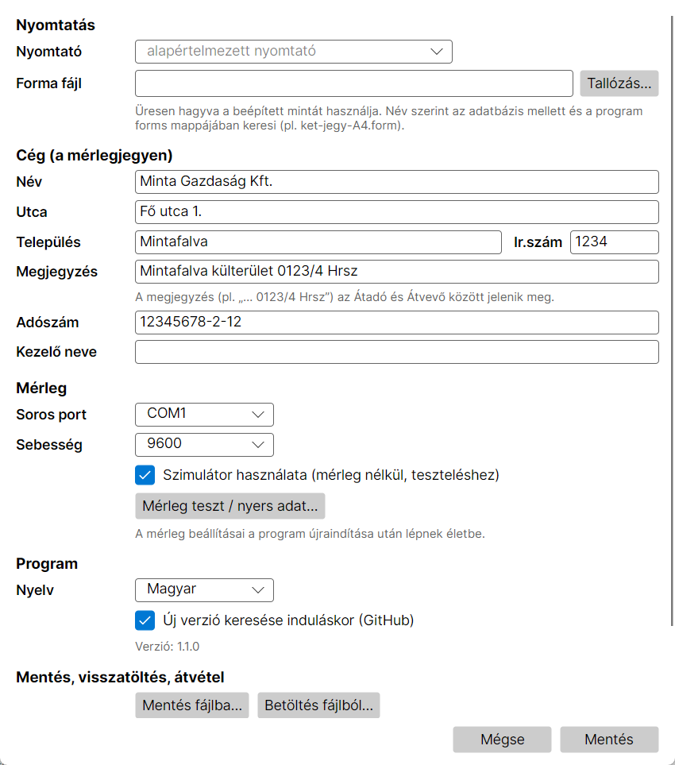

- **Nyomtató:** a mérlegjegyek és az összesítők nyomtatója. Az előnézet ablakokban is át lehet állítani.
- **Forma fájl:** a mérlegjegy elrendezése (a régi program `.form` fájljai is jók). Ha üresen marad, a beépített mintát használja: két jegy egy A4-es lapon. A program mellett lévő `forms` mappában kész minták vannak, ezek név szerint is megadhatók:
  - `ket-jegy-A4.form`: két jegy egy A4-es lapon (kettévágható),
  - `egy-jegy-A4.form`: egy jegy a lap tetején,
  - `two-tickets-A4-en.form`: két jegy angolul.

  A minták a cégnevet és -címet, valamint a megjegyzést (pl. hrsz) a Beállításból veszik, így bármelyik gazdaság használhatja őket.
- **Cég:** a jegy fejlécében szereplő adatok. A **Megjegyzés** (pl. „… 0123/4 Hrsz”) az Átadó és Átvevő aláírás között jelenik meg.
- **Mérleg:** soros port és sebesség (a mérleg 9600 baudon küld), valamint a **Szimulátor** mérleg nélküli próbához. A szimulátor be- és kikapcsolása a program újraindítása után lép életbe.

### Mentés, visszatöltés, átvétel

A **Beállítás** ablak alján:
- **Mentés fájlba…:** minden beállítás egy `.tssettings` fájlba kerül: nyomtató, cégadatok, mérleg port és formátum, nyelv, valamint a mérlegjegy minta is.
- **Betöltés fájlból…:** egy korábban mentett fájlból visszatölti őket, például új gépen vagy újratelepítés után. A mérlegjegy mintát a program az adatbázis mellé írja vissza.

A fájlban csak beállítások vannak, mérések nincsenek. Az adatokat a `truckscale.db` másolásával lehet menteni (lásd [Adatok és mentés](#adatok-és-mentés)).

### Mérleg teszt / nyers adat

A **Beállítás → Mérleg teszt / nyers adat…** gombbal lehet a mérlegműszer illesztését belőni:

1. **Kapcsolat:** soros port, sebesség, paritás, adatbit, stopbit és sorvége (a BWS műszer CR LF-et küld). A **Kapcsolódás** után alul **élőben látszik minden, amit a műszer küld**, a láthatatlan karakterekkel együtt (`<CR>`, `<LF>`).
2. **Sebesség keresése:** ha nem tudod a sebességet, a program sorban végigpróbálja a gyakoriakat (9600, 4800, 2400, 19200 …), és azt választja, amelyiken értelmes sorok jönnek.
3. **Feldolgozás:** melyik karakterek jelentik a stabil jelzést és a súlyt.
   - **BWS (ST,GL,…kg):** a régi program beállítása. A stabil jelzés a 0. helyen 2 hosszan, értéke „ST”; a súly a 6. helytől 8 hosszan, 0 tizedesjeggyel.
   - **Automatikus:** a program maga ismeri fel az `ST/US/OL,GL/NT,…kg` sorokat.
   - **Egyéni:** bármilyen kezdet és hossz megadható; a mezők átírásakor ide vált.
4. A középső szürke dobozban az utolsó sor fölött egy **pozícióvonalzó** (0123456789…) van, alatta a jelölés (`SS    WWWWWWWW`): `S` = stabil jelzés, `W` = súly. Alatta azonnal látszik az eredmény, például **Stabil: igen, Súly: 23 480 kg**.
5. **Próba sor:** mérleg nélkül is kipróbálható, ha beírsz vagy bemásolsz egy sort.
6. **Mentés:** a program újraindítás nélkül az új beállítással kapcsolódik a mérleghez.

Amíg ebben az ablakban kapcsolódsz, a program saját mérlegkapcsolata szünetel. Ha a portot másik program (pl. a régi TS.exe) használja, a hibaüzenet alul jelenik meg.

## Átvétel a régi programból

Az új gépen elég egyszer elvégezni: **Beállítás → Átvétel a régi programból (TS.ini, DATA.LIS)…**

1. A program magától megkeresi a régi Truck Scale fájljait: a `Program Files` alatt, a Windows *VirtualStore* mappájában, a Dokumentumokban és az Asztalon. A régi program a Windows miatt sokszor nem a saját mappájába írt, hanem a `%LOCALAPPDATA%\VirtualStore\…` alá. Az új program ezért azt a fájlt választja ki, amelyiket a régi ténylegesen használta. A listában ott van mellette a dátum és a méret is.
2. Ha nem a jó fájl van kiválasztva, válassz másikat a listából, használd a **Tallózás…** gombot, vagy a **Keresés mappában…** gombbal adj meg egy mappát (pl. egy pendrive-ot a régi gép fájljaival).
3. Jelöld be, mit veszel át:
   - **Beállítások (TS.ini):** cégadatok és HRSZ, kezelő, mérleg port, sebesség és formátum (BWS), nyomtató, mérlegjegy minta. A mintát a program az adatbázis mellé másolja.
   - **Adatok (DATA.LIS):** ügyfelek, járművek, sofőrök, anyagok és minden mérés. A duplikált rendszámokat és neveket a program összevonja. A végén ellenőrzi, hogy a régi és az új összesítők évenként egyeznek-e.
4. **Átvétel.** A napló ablakban látszik minden lépés. Az adatok átvétele **lecseréli a jelenlegi adatbázist** (előtte mentés készül), majd a program újraindul.

A régi `DATA.LIS` fájlhoz az átvétel nem nyúl, egy ideiglenes másolatból dolgozik. Az adatok átvétele csak Windowson lehetséges. A beállítások bármelyik gépen átvehetők. Részletek: [DATABASE.md](DATABASE.md).

## Adatok és mentés

- Minden adat a `truckscale.db` fájlban van. **Rendszeresen másold el** pendrive-ra vagy felhőbe, például hetente és a betakarítás végén. Ha bezárt programmal másolod, biztosan ép lesz a mentés.
- Visszaállítás: a mentett fájlt kell a helyére másolni.
- **A régi program (TS.exe) adatai:** lásd lent, *Átvétel a régi programból*.
- Minden átvétel előtt a program biztonsági mentést készít a jelenlegi adatbázisról (`truckscale-backup-<dátum>.db`), ugyanabba a mappába.

## Gyakori kérdések

**„NINCS KAPCSOLAT” a kijelzőn.**
- Be van kapcsolva a mérleg, és be van dugva a kábel?
- Jó a soros port a Beállításban?
- Nem fut a régi TS.exe? Az lefoglalja a portot.

**A Mérés gomb szürke.** A gomb melletti piros szöveg megmondja, miért, például:
- „A mérleg nem stabil”,
- „Válassza ki az ügyfelet”,
- „A mérleg negatív súlyt mutat”.

**Kicsinyítve (pl. 60%-on) nyomtat.** A program mindig A4-es lapot kér. Ha a nyomtató ennek ellenére kicsinyít, a Beállításban válaszd a nyomtató **saját illesztőprogramos** bejegyzését (pl. „NPI04DBCD (HP LaserJet …)”) a Windows általános bejegyzése helyett. Az általános bejegyzés a „Microsoft IPP Class Driver”, ez lapra igazítással kicsinyíthet.

**Lassú az első nyomtatás.** A nyomtató illesztőprogramjának első betöltése 10 másodperc körül is lehet. A program ezt indításkor a háttérben elvégzi, utána a nyomtatás gyors. Ha tartósan lassú, próbáld ki a Beállításban ugyanannak a nyomtatónak a másik bejegyzését (pl. hálózati helyett USB-s).

**Elrontottam egy bent lévő mérést.** Stornó, majd új mérés. Lezárt jegyet nem lehet módosítani.
